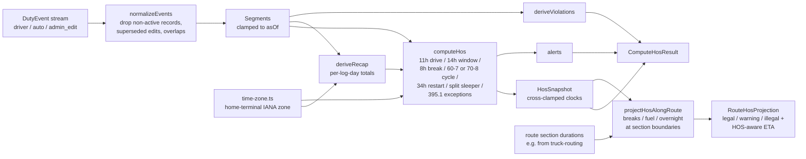

# hos-engine

A pure TypeScript hours-of-service (HOS) engine for US property-carrying
drivers: duty-status normalization, the 11/14/8/70 clocks, split sleeper,
short-haul exceptions, home-terminal time zones, and route HOS projection.
No I/O, no dependencies at runtime.

## Why this exists

An ELD-backed dispatch app has to answer "how long can this driver still drive?"
from a messy stream of duty events: late edits, overlapping records,
carrier-proposed changes the driver has not accepted yet, and log days that
follow the driver's home terminal instead of UTC. Getting it wrong either
strands a truck or puts a driver out of compliance. This engine was extracted
from a production trucking operations platform, where it is the single
authority for duty state that the mobile app, dispatcher board, and alerting
all read from.

## Architecture



Key decisions and tradeoffs:

- **Record status is enforced at normalization, not in the rules.** Only
  `active` records (49 CFR 395 Appendix A) survive `normalizeEvents`, so a
  carrier-proposed edit (`inactive_change_requested`) cannot change a driver's
  hours until the driver accepts it (395.30(c)). Rows with no `recordStatus`
  are treated as `active` so older data keeps its meaning.
- **Display clocks are cross-clamped.** `drivingRemainingMs` never shows more
  drive time than the duty window or cycle allows, because that is the number a
  driver acts on. `drivingLimitRemainingMs` keeps the raw 11-hour clock so
  callers (and alerts) can tell which limit is actually binding.
- **Exceptions are opt-in facts, never inferred.** Sleeper-berth split (7/3 and
  8/2), the adverse-driving extension, the 150-air-mile short-haul break
  exemption, and the 16-hour short-haul window only apply when the caller
  asserts the qualifying facts in `HosConfig`. The engine does not guess at
  evidence it cannot see.
- **Log days follow the home terminal.** `time-zone.ts` uses `Intl` to compute
  DST-correct local midnights (a spring-forward day is 23 hours, not 24), so
  recaps and cycle windows match what an inspector sees on the driver's log.
- **Route projection is an estimate, not a certification.** It walks route
  section drive times against the remaining clocks and inserts 30-minute
  breaks, optional fuel stops, and 10-hour resets at section boundaries. It is
  deliberately conservative (breaks and fuel draw down the 14-hour window; the
  cycle is surfaced as a warning rather than modelled minute by minute).
  `computeHos` stays the authority for actual duty state.

### Pairs with truck-routing

[`truck-routing`](https://github.com/treyktw/truck-routing) picks the safest
truck-legal route candidate. Feed that candidate's per-section
`durationSeconds` into `projectHosAlongRoute` here to get where the driver has
to stop and an HOS-aware ETA for the trip.

## Quick start

Requires Node 20.11+ and pnpm 9.

```bash
pnpm install
pnpm test
pnpm typecheck
pnpm demo
```

`pnpm demo` runs [`examples/route-projection.ts`](examples/route-projection.ts):
it computes live clocks for a synthetic driver mid-shift, then projects them
over a 12-hour, three-section route. Output:

```text
Live clocks at 2026-03-02T17:00:00.000Z
{
  currentStatus: 'driving',
  drivingRemaining: '6.50h',
  dutyWindowRemaining: '9.00h',
  breakRequiredIn: '3.50h',
  cycleRemaining: '65.00h',
  alerts: 0
}

Route HOS projection
{
  legality: 'warning',
  breaksRequired: 1,
  overnightRequired: true,
  totalDriving: '12.00h',
  hosAwareEta: '23.00h'
}
  - break     after section 0, 0.5h: 30-minute break required after 8 hours of driving.
  - fuel      after section 0, 0.5h: Planned fuel stop.
  - overnight after section 0, 10.0h: 10-hour reset required before the driver can continue legally.
```

Library usage:

```ts
import { computeHos, projectHosAlongRoute } from "./src";

const { snapshot } = computeHos({
  events,
  recapDays: [],
  config: { cycleRule: "70_8", reminderLeadSeconds: 1800, homeTerminalTimezone: "America/Chicago" },
  asOf: Date.now(),
});

const plan = projectHosAlongRoute({
  drivingRemainingSeconds: snapshot.drivingRemainingMs / 1000,
  dutyWindowRemainingSeconds: snapshot.dutyWindowRemainingMs / 1000,
  breakRequiredInSeconds: snapshot.breakRequiredInMs === null ? null : snapshot.breakRequiredInMs / 1000,
  cycleRemainingSeconds: snapshot.cycleRemainingMs / 1000,
  sectionDurationsSeconds: [3 * 3600, 4 * 3600, 5 * 3600],
});
// plan.insertions -> [{ type: "break", ... }, { type: "overnight", ... }]
```

### What is in `src/`

| File | Responsibility |
| --- | --- |
| `normalize-events.ts` | Appendix A record status, edit supersession, sort, overlap resolution |
| `compute-hos.ts` | Clocks, resets, split sleeper, 395.1 exceptions, alerts |
| `derive-recap.ts` | Per-log-day on-duty / driving / off / sleeper totals |
| `derive-violations.ts` | 11-hour, 14-hour, break, and cycle violations |
| `time-zone.ts` | Home-terminal log days and DST-correct midnights |
| `project-route-hos.ts` | Break / fuel / overnight insertion along a route |
| `constants.ts`, `types.ts` | Regulatory limits and the public types |

## Tests

```bash
pnpm test
```

72 Vitest tests across 6 files:

- `compute-hos.test.ts`, `edge-cases.test.ts`: core clocks, boundaries, and
  malformed or overlapping timelines.
- `fmcsa-scenarios.test.ts` with `tests/fixtures/fmcsa-property-carrying.ts`:
  property-carrying scenarios for 49 CFR 395.3 and the 395.1 exceptions (split
  sleeper, 34-hour restart, adverse driving, short haul, 16-hour window),
  written as synthetic timeline facts rather than implementation-specific
  unit cases.
- `time-zone.test.ts`: home-terminal day boundaries, DST transitions, and
  recap distribution.
- `record-status.test.ts`: Appendix A record status and edit acceptance.
- `project-route-hos.test.ts`: break, fuel, and overnight insertion along a
  route and the legality verdicts.

All timelines are synthetic. Nothing here is a real driver's log.

## What was left out

The production package also has a fixture-parity test against a sibling Rust
port of this engine; that crate is not part of this repository, so the test was
left out. Also excluded: the ELD event ingestion and persistence layer, the
database schema, auth, the dispatcher and driver UIs that render these clocks,
push-notification delivery for alerts, and deployment config. What remains is
the pure rules engine with its own types.


## License

MIT. See [LICENSE](LICENSE).
